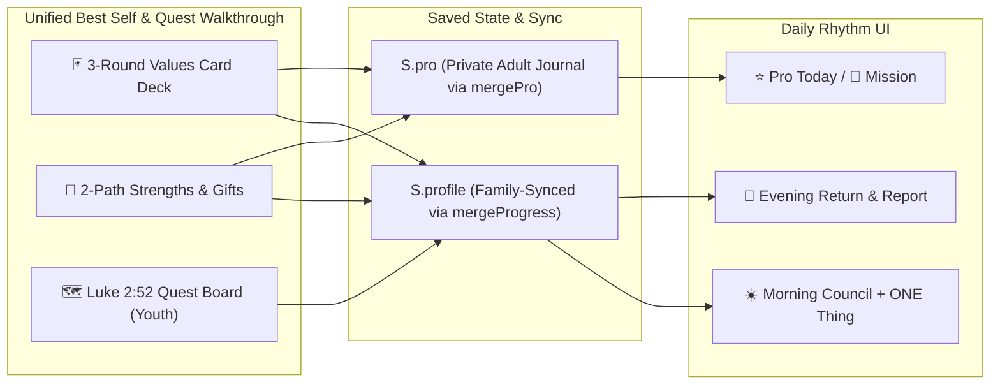

# Best Self, Values Card Deck & Youth Quest Implementation Plan

This plan captures all six design decisions from our `/grill-me` session and maps out the surgical implementation in [index.html](file:///Users/blakemerrell/Documents/TreasureUp/index.html) and [tests/](file:///Users/blakemerrell/Documents/TreasureUp/tests) on a dedicated feature branch (`gemini/best-self-discovery`).

> [!TIP]
> **Playable Mockup Ready Now**: You can test the interactive 3-Round Values Card Deck sort, the 2-Path StrengthsFinder discovery quiz, the plain-English Morning/Evening flow, and Javan's Luke 2:52 Quest Board right now in [new_user_best_self_onboarding_mockup.html](file:///Users/blakemerrell/.gemini/antigravity/brain/a8262abc-7fc3-43a4-90b7-92a8ca492de0/new_user_best_self_onboarding_mockup.html).

---

## 1. Design Decisions Locked In (`/grill-me` Summary)

1. **Unified Walkthrough + On-Demand Exercises**:
   - Expand the existing Growth Coach setup ([`openCoachProfile`](file:///Users/blakemerrell/Documents/TreasureUp/index.html#L3952-L4244)) into a unified, step-by-step **Best Self & Growth Quest Walkthrough** that adapts automatically to **Adult** vs. **Child/Youth** profiles.
   - Add direct launch buttons inside the Season Notebook's **🧭 Mission** tab ([`proMissionHtml`](file:///Users/blakemerrell/Documents/TreasureUp/index.html#L10280-L10345)) so you can re-open or update the **Values Card Deck**, **Strengths Finder**, or **90-Day Goals** anytime.
2. **3-Round Interactive Values Card Deck Exercise (+ Fast-Track)**:
   - **Round 1 (Sort the Deck)**: Sort ~30–45 core value cards into **🔥 Core to Me**, **👍 Important**, or **👋 Pass** (with a toggle between **Card-by-Card Deal** and **Full Grid Tap-to-Pick**, plus custom card creation).
   - **Round 2 (Pick 3 Anchor Pillars)**: Select 3 umbrella Anchor Pillars from your Core pile (e.g., **FAITH**, **ADVENTURE**, **INTEGRITY**).
   - **Round 3 (Tuck Supporting Sub-Values Underneath)**: Group your remaining Core cards underneath each of your 3 Anchor Pillars—recreating your physical card board (`FAITH` → *Humility, Gratitude, Wisdom*; `ADVENTURE` → *Love, Perseverance, Generosity*; `INTEGRITY` → *Honesty, Accountability, Stewardship*).
   - **Fast-Track & Kid Deck**: Includes a 1-click **"I Already Know My 3 Pillars / Preset"** button for adults, and a shorter **12–18 card Hero Badges Deck** for kids/youth.
3. **Two-Path StrengthsFinder & Spiritual Gifts Discovery**:
   - **Path A ("Help Me Discover Mine" — 5-Question Scenario Quiz)**: Real-life scenario prompts (*"When a big project starts, what is your natural first move?"*, *"What do people most often come to you for?"*) that score and recommend your Top 5 CliftonStrengths + Spiritual Gifts (Moroni 10 / D&C 46).
   - **Path B ("I Know My Strengths" — Direct Picker)**: Tap up to 5 strengths directly from the 34 CliftonStrengths themes (grouped by *Executing*, *Influencing*, *Relationship Building*, *Strategic Thinking*) + Spiritual Gifts + Adult Executive Interests (*Business / Building*, *Writing / Creating*, *Financial Stewardship*).
4. **Plain-English Daily Morning Council & Evening Return & Report**:
   - **Retire Confusing Jargon**: Permanently avoid the phrase *"Effort without grace becomes performance..."* and skip Hebrew/Greek labels (*Hesed* / *Agape*) in the daily sheets.
   - **Morning Council ([`blueprintSheetHtml`](file:///Users/blakemerrell/Documents/TreasureUp/index.html#L4247-L4297)) & Pro Today ([`proTodayHtml`](file:///Users/blakemerrell/Documents/TreasureUp/index.html#L10162-L10220))**:
     - Show your **Core Values Triad** badge header at the top.
     - Ask Gary Keller's **The ONE Thing Focusing Question**: *"What is the ONE thing I can do today such that by doing it, everything else will be easier or better?"*
     - Ask plain-English discipleship prompts: *"How is God teaching or helping me in today's reading?"* and *"Who is ONE person I can help, encourage, or lift today?"*
   - **Evening Return & Report ([`eveningSheetHtml`](file:///Users/blakemerrell/Documents/TreasureUp/index.html#L4362-L4387))**:
     - Check off today's **ONE Thing**.
     - Ask plain-English reflection prompts: *"How did God help me today? Where did I see His hand?"*, *"How did I live my Core Values or help someone today?"*, and *"What unfinished worry can I hand over to the Savior tonight?"*
5. **Child & Youth Experience (Luke 2:52 Quest Board + Theme Switcher)**:
   - When a Child or Youth profile is active (`seasonWho() !== 'adult'`), transform the Goals & Coach view into a playful **Luke 2:52 Quest Board** across the 4 growth areas (**Spiritual**, **Social**, **Physical**, **Intellectual**) and the Church's *Children's Guidebook* 4-step adventure loop (**Discover 🔍 → Plan 🗺️ → Act ⚔️ → Celebrate 🎉**).
   - Include a 3-way theme toggle (**🎮 Nintendo Playful** default, **👾 16-Bit Retro RPG**, and **📘 Classic Guidebook**).

---

## 2. Data Model & Sync Architecture



- **`S.profile` Additions** (preserved across devices in [`mergeProgress`](file:///Users/blakemerrell/Documents/TreasureUp/index.html#L10520-L10650)):
  - `valuesTriad`: `[{ id, name, subValues: [...] }, ...]` (up to 3 Anchor Pillars + tucked sub-values)
  - `valuesCorePile`: `string[]` (saved card IDs from Round 1 so re-opening the deck remembers your pile)
  - `topStrengths`: `string[]` (up to 5 CliftonStrengths / discovered strengths)
  - `spiritualGifts`: `string[]` (selected Moroni 10 / D&C 46 gifts)
  - `youthTheme`: `'nintendo' | 'rpg' | 'booklet'`
  - `youthQuests`: `{ spiritual, social, physical, intellectual }` (each with `{ goal, step, updatedAt }`)
- **`S.pro` Additions** (preserved in private adult Firestore journal via [`mergePro`](file:///Users/blakemerrell/Documents/TreasureUp/index.html#L10380-L10440)):
  - `S.pro.valuesTriad`: synced with `S.profile.valuesTriad` for adult mode so the **🧭 Mission** and **⭐ Today** tabs display the 3-Pillar Board and allow linking 90-Day Goals (`S.pro.goals`) and Daily Top Priorities (`S.pro.tops[dateKey].oneThing`) to a Core Pillar.
- **Privacy Rule (`GEMINI.md` Rule 4)**:
  - No child's personal details, age, or birthday will be hardcoded in the repository; all profile data is entered by the family in the app and stored in `localStorage` / family sync.

---

## 3. Files Affected & Phased Execution

| File | What Changes |
| :--- | :--- |
| [index.html](file:///Users/blakemerrell/Documents/TreasureUp/index.html) | 1. Add Values Card Deck data + 3-Round interactive card sort UI & handlers.<br>2. Add 2-Path StrengthsFinder (5-question quiz + 34-theme browser) & Spiritual Gifts.<br>3. Add Child/Youth Luke 2:52 Quest Board + 3-theme CSS variables (`nintendo`, `rpg`, `booklet`).<br>4. Update `blueprintSheetHtml`, `eveningSheetHtml`, `proTodayHtml`, and `proMissionHtml` with the Core Values Triad banner, Gary Keller's *The ONE Thing* question, and plain-English prompts.<br>5. Update `mergeProgress` and `mergePro` so all new fields survive multi-device family sync. |
| [tests/run.mjs](file:///Users/blakemerrell/Documents/TreasureUp/tests/run.mjs) | Add automated Playwright tests verifying:<br>- Values Card Deck 3-round sort & Pillar + Sub-value persistence<br>- Strengths 5-question quiz & Top 5 selection<br>- Plain-English Morning Council (`oneThing`) & Evening Return & Report<br>- Child/Youth Luke 2:52 Quest Board & theme toggle<br>- `mergeProgress` preservation of `valuesTriad`, `topStrengths`, and `youthQuests` |

### Pre-Flight Cleanup
- Before creating the `gemini/best-self-discovery` branch from `main`, remove the untracked preview file `new_user_best_self_onboarding_mockup.html` from the repo root (keeping it safely in the artifacts folder) and confirm `git status` is clean per `GEMINI.md` Rule 4.

---

## 4. Verification & Rollback Plan

1. **Syntax & Parse Check**:
   ```bash
   node tools/check-parse.mjs
   ```
2. **Content & Integrity Check**:
   ```bash
   node tools/verify.mjs
   ```
3. **Browser & Sync Suite**:
   ```bash
   cd tests && node run.mjs
   ```
4. **Rollback Plan**:
   - All work happens on branch `gemini/best-self-discovery` (never committing to `main`). Any change can be reverted cleanly via `git checkout main`.
